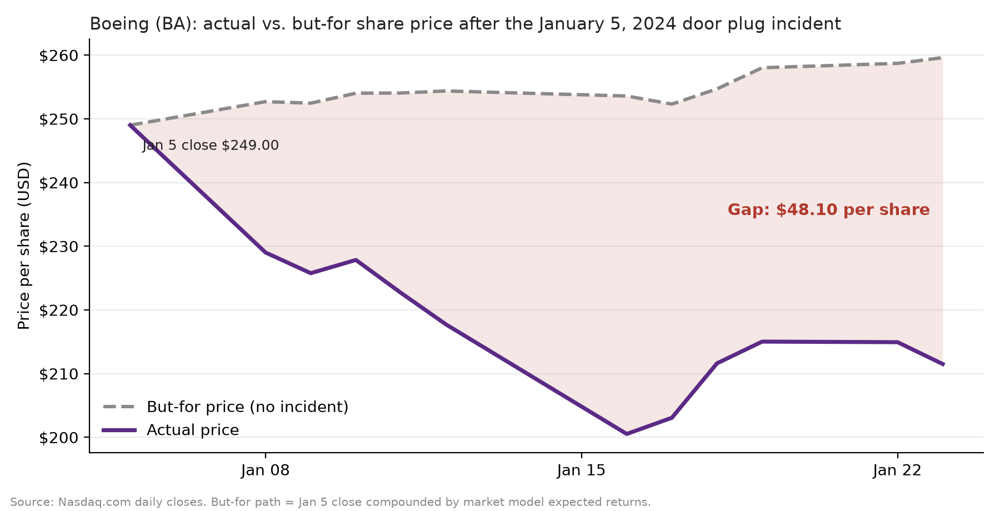
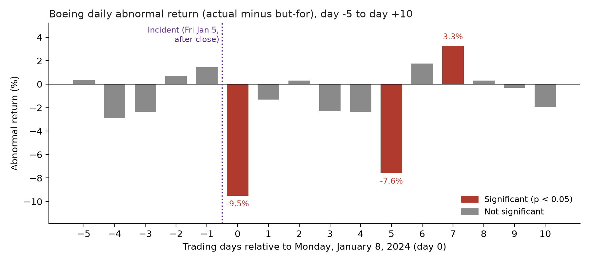

# Boeing Event Study: Alaska Airlines Flight 1282 Door Plug Incident

## Assignment

**Question.** How did Boeing's stock price react to the January 5, 2024 Alaska Airlines Flight 1282 door plug incident and the FAA grounding that followed, separate from normal market movement?

**Scope.** Measure the price impact of the incident on Boeing common stock: the abnormal return on the first trading day and over short windows after it, its statistical significance, and the matching change in market value. The analysis uses public data only. It does not estimate shareholder damages, which would also require a class period, an inflation ribbon and a trading model.

## Answer

On Monday, January 8, 2024, the first trading day after the incident and the FAA grounding of 737 MAX 9 jets announced January 6, Boeing stock returned **-8.03%** while a market model predicted **1.48%**. The difference, an abnormal return of **-9.52%**, is statistically significant (t = -6.13, p < 0.001). That is an abnormal change in market value of **-$14.46 billion** in one day.

By January 23, 2024 (day +10), Boeing closed at $211.50 against a but-for price of $259.60, a gap of **$48.10 per share**.

The day 0 result holds across 6 alternative model setups (abnormal return -9.76% to -9.38%; see [Sensitivity analysis](#sensitivity-analysis)).



### Cumulative abnormal return (CAR) by window

Day 0 is the headline result. The longer windows are sensitivity checks, chosen before looking at the results, and they mix in later news.

| Window | Dates | Abnormal return | t-stat | p-value | Abnormal change in market value |
|---|---|---|---|---|---|
| [0] | Jan 8 | -9.52% | -6.13 | < 0.001 | -$14.46 billion |
| [0, +1] | Jan 8 to Jan 9 | -10.84% | -4.94 | < 0.001 | -$16.30 billion |
| [0, +5] | Jan 8 to Jan 16 | -22.75% | -5.99 | < 0.001 | -$32.33 billion |
| [0, +10] | Jan 8 to Jan 23 | -19.67% | -3.82 | < 0.001 | -$28.68 billion |

The dollar column (an abnormal change in market value, not a loss or damages figure) adds up each day's abnormal dollar change. The $48.10 per-share gap on the chart compounds returns forward from the January 5 close instead, so the two measures are close but not identical.

### Daily abnormal returns, day -5 to day +10



No day before the incident is significant, which supports the model. After the incident, day 0 and day +5 (January 16) show large significant drops, and day +7 (January 18) shows a significant partial rebound.

## Method

This is a standard market model event study, the approach used in securities litigation and economic damages work. The design was fixed before looking at the results.

1. **Returns.** Daily simple returns for Boeing (BA) and the S&P 500 ETF (SPY), the market proxy.
2. **Event day (day 0).** Monday, January 8, 2024. The incident happened Friday evening, January 5, after the market closed, so January 8 is the first trading reaction.
3. **Estimation window.** 250 trading days, November 23, 2022 to November 21, 2023, ending 30 trading days before day 0 so that pre-event news does not leak into the model.
4. **Market model.** OLS regression `BA_return = alpha + beta * SPY_return + error`. Result: alpha = 0.000559, beta = 1.0003, R-squared = 0.257, residual SD = 1.55%. Full output in [`output/market_model_summary.txt`](output/market_model_summary.txt).
5. **But-for return.** `alpha + beta * SPY_return` on each event day: what Boeing would have returned given that day's market move if the incident had not happened.
6. **Abnormal return (AR).** Actual minus but-for. t-stat = AR / residual SD, with a two-sided p-value from the t-distribution (248 degrees of freedom).
7. **Cumulative abnormal return (CAR).** Sum of ARs over [0], [0, +1], [0, +5] and [0, +10]. t-stat = CAR / (residual SD x sqrt(number of days)).
8. **Dollar impact.** For each day, AR x prior day close x shares outstanding, summed over the window. Shares outstanding: 610,135,205 as of January 24, 2024 ([Boeing FY2023 Form 10-K cover page](https://www.sec.gov/Archives/edgar/data/12927/000001292724000010/ba-20231231.htm)).
9. **But-for price path.** Start from the January 5, 2024 close ($249.00) and compound actual and expected returns forward to show the per-share gap.

## Sensitivity analysis

The main design (250-day estimation window ending 30 trading days before the event) was fixed in advance. Each row below changes one choice and reruns the same code. The last row skips the regression entirely and treats Boeing's abnormal return as its return minus SPY's.

| Setup | Beta | Residual SD | Day 0 AR | Day 0 t-stat | CAR [0, +5] | CAR [0, +10] | Day 0 abnormal change in market value |
|---|---|---|---|---|---|---|---|
| Main analysis: 250-day estimation window, 30-day gap | 1.0003 | 1.55% | -9.52% | -6.13 | -22.75% | -19.67% | -$14.46 billion |
| Shorter estimation window (120 days) | 0.9592 | 1.61% | -9.40% | -5.84 | -22.33% | -18.85% | -$14.28 billion |
| Longer estimation window (500 days) | 1.1854 | 1.98% | -9.76% | -4.93 | -22.92% | -20.12% | -$14.83 billion |
| No gap before the event | 1.0062 | 1.49% | -9.47% | -6.36 | -22.42% | -19.05% | -$14.38 billion |
| Longer gap (60 days) | 0.8762 | 1.72% | -9.38% | -5.45 | -22.84% | -19.71% | -$14.26 billion |
| Market-adjusted model (alpha = 0, beta = 1) | 1.0000 | 1.55% | -9.46% | -6.11 | -22.42% | -19.05% | -$14.37 billion |

Across all 6 setups the day 0 abnormal return ranges from -9.76% to -9.38%, the t-stat from -6.36 to -4.93, and the abnormal change in market value from -$14.83 billion to -$14.26 billion. Full results, including every window, are in [`output/sensitivity_analysis.csv`](output/sensitivity_analysis.csv).

### Additional robustness checks

These checks change how the model is estimated rather than the window. They are kept separate from the table above.

| Check | Estimation days | Beta | R-squared | Residual SD | Day 0 AR | Day 0 t-stat |
|---|---|---|---|---|---|---|
| Base case (250-day window, 30-day gap, simple returns) | 250 | 1.0003 | 0.257 | 1.55% | -9.52% | -6.13 |
| Smaller gap (10 days) | 250 | 0.9970 | 0.238 | 1.51% | -9.50% | -6.28 |
| Log returns instead of simple returns | 250 | 1.0035 | 0.259 | 1.55% | -9.84% | -6.37 |
| 5 largest estimation-window residuals removed | 245 | 1.0280 | 0.327 | 1.35% | -9.52% | -7.05 |

Across these checks the day 0 abnormal return ranges from -9.84% to -9.50% and the t-stat from -7.05 to -6.13. Source: [`output/robustness_table.csv`](output/robustness_table.csv).

## Statistical appendix

### Formulas

- Market model, fit by OLS on the estimation window: `R_BA,t = alpha + beta x R_SPY,t + e_t`
- Expected (but-for) return on event day t: `E[R_BA,t] = alpha + beta x R_SPY,t`
- Abnormal return: `AR_t = R_BA,t - E[R_BA,t]`
- Cumulative abnormal return over days t1 to t2: `CAR = sum of AR_t`
- Test statistics, with sigma the residual standard deviation and L the number of days: `t = AR_t / sigma` and `t = CAR / (sigma x sqrt(L))`, two-sided p-values from the t-distribution with 248 degrees of freedom
- Abnormal change in market value: `AR_t x prior close x shares outstanding`, summed over the window

### Descriptive statistics, estimation window

| Series | Days | Mean | Median | Std dev | Min | Max | Skewness | Excess kurtosis | Lag-1 autocorrelation |
|---|---|---|---|---|---|---|---|---|---|
| BA daily return | 250 | 0.11% | 0.17% | 1.80% | -5.56% | 8.72% | 0.18 | 2.26 | -0.01 |
| SPY daily return | 250 | 0.05% | 0.04% | 0.91% | -2.45% | 3.15% | 0.07 | 0.04 | 0.04 |
| Market model residual | 250 | 0.00% | 0.04% | 1.55% | -5.37% | 8.65% | 0.55 | 4.02 | 0.00 |

The residuals average zero by construction. Lag-1 autocorrelation near zero supports treating daily abnormal returns as independent, which the CAR t-stat assumes. Excess kurtosis above zero means fatter tails than a normal distribution, which is why the check below is useful. Source: [`output/descriptive_statistics.csv`](output/descriptive_statistics.csv).

### Distribution-free check

The residuals have fat tails (excess kurtosis 4.02; Jarque-Bera test of normality p < 0.001), so the t-test p-values are approximate. Without assuming normality: over the 250-day estimation window the market model's daily residuals ranged from -5.37% to 8.65%, and 0 of 250 days had a surprise at least as large in absolute value as the day 0 abnormal return of -9.52%. In plain words, day 0 was larger than every daily surprise in the 250-day estimation window.

### Largest surprises in the estimation window

To check that the estimation window was not contaminated by unusual Boeing news, these are its 5 largest absolute residuals. At least two match Boeing-specific news. Removing all 5 and refitting leaves the day 0 abnormal return essentially unchanged (see the last row of the robustness table above).

| Date | BA return | SPY return | Residual | t-stat | Known Boeing-specific news |
|---|---|---|---|---|---|
| July 26, 2023 | 8.72% | 0.02% | 8.65% | 5.58 | Boeing second-quarter 2023 earnings release |
| April 14, 2023 | -5.56% | -0.24% | -5.37% | -3.46 | Boeing announced a 737 MAX supplier quality issue after the April 13 close |
| December 2, 2022 | 4.03% | -0.12% | 4.09% | 2.64 | Not identified |
| November 13, 2023 | 4.01% | -0.10% | 4.05% | 2.61 | Not identified |
| February 2, 2023 | -2.52% | 1.46% | -4.03% | -2.60 | Not identified |

Source: [`output/largest_estimation_residuals.csv`](output/largest_estimation_residuals.csv).

### Data notes

How the raw files were checked and cleaned (row counts, duplicates, missing values, market holidays, dividend treatment, shares outstanding source) is documented in [`output/data_notes.txt`](output/data_notes.txt), which the script generates.

## How to run

Requires Python 3.11 or later.

```bash
pip install -r requirements.txt
python event_study.py
```

The script reads `data/ba.csv` and `data/spy.csv` and writes everything to `output/`:

| File | Contents |
|---|---|
| `actual_vs_but_for_price.png` | Actual vs. but-for price, gap shaded |
| `daily_abnormal_returns.png` | Daily ARs from day -5 to +10, significant days highlighted |
| `daily_abnormal_returns.csv` | Daily returns, expected return, AR, t-stat, p-value, dollar impact |
| `cumulative_abnormal_returns.csv` | CAR by window with t-stat, p-value, dollar impact |
| `market_model_summary.txt` | Full regression output |
| `key_results.txt` | Headline numbers, formatted exactly as quoted in this README and the memo |
| `Findings_Summary.pdf` | One-page memo for a non-technical reader |
| `sensitivity_analysis.csv` | Results under 6 alternative model setups |
| `descriptive_statistics.csv` | Summary statistics for the estimation window |
| `data_notes.txt` | Data checks and cleaning steps |
| `robustness_table.csv` | Day 0 result under additional robustness checks |
| `largest_estimation_residuals.csv` | The 5 largest surprise days in the estimation window |

### Interactive view

A small Streamlit page lets you pick any event window from day -5 to day +10 and see the cumulative abnormal return, t-stat, p-value, dollar impact, and charts for that window. It uses the same calculations as `event_study.py`.

```bash
streamlit run app.py
```

To refresh the data, go to the Nasdaq.com historical data page for [BA](https://www.nasdaq.com/market-activity/stocks/ba/historical) and [SPY](https://www.nasdaq.com/market-activity/etf/spy/historical), choose the 5Y range, click "Download historical data", and save the files as `data/ba.csv` and `data/spy.csv`.

## Limitations

- **Overlapping news.** The FAA grounded 171 Boeing 737 MAX 9 jets on Saturday, January 6, so day 0 reflects the incident and the grounding together. Later news, including the FAA investigation and added production oversight, overlaps the longer windows, so multi-day CARs mix several events. This is why day 0 is the headline.
- **Dividends.** SPY closing prices are not dividend-adjusted. The effect is negligible over these windows.
- **Single-factor model.** Only the broad market is controlled for. A fuller analysis could add an aerospace or industrials index as a second factor.
- **Not a damages opinion.** This is an educational analysis of public data. Shareholder damages in a real case depend on trading patterns, class periods, and legal theory.

## Materials relied upon

- Daily closing prices for BA and SPY: [Nasdaq.com historical data](https://www.nasdaq.com/market-activity/stocks/ba/historical), 5-year range, retrieved October 21, 2026. Columns: `Date, Close/Last, Volume, Open, High, Low`.
- Boeing FY2023 Form 10-K, cover page (shares outstanding as of January 24, 2024): [SEC EDGAR](https://www.sec.gov/Archives/edgar/data/12927/000001292724000010/ba-20231231.htm).
- FAA Emergency Airworthiness Directive of January 6, 2024, grounding certain Boeing 737 MAX 9 aircraft for inspection.
- Boeing press release of January 4, 2024 announcing fourth-quarter results on January 31, 2024: [Boeing Investor Relations](https://investors.boeing.com/investors/news/press-release-details/2024/Boeing-to-Release-Fourth-Quarter-Results-on-January-31/default.aspx).
- MacKinlay, A. C. (1997). Event Studies in Economics and Finance. *Journal of Economic Literature*, 35(1), 13 to 39.
- Brown, S. J. and Warner, J. B. (1985). Using Daily Stock Returns: The Case of Event Studies. *Journal of Financial Economics*, 14(1), 3 to 31.
